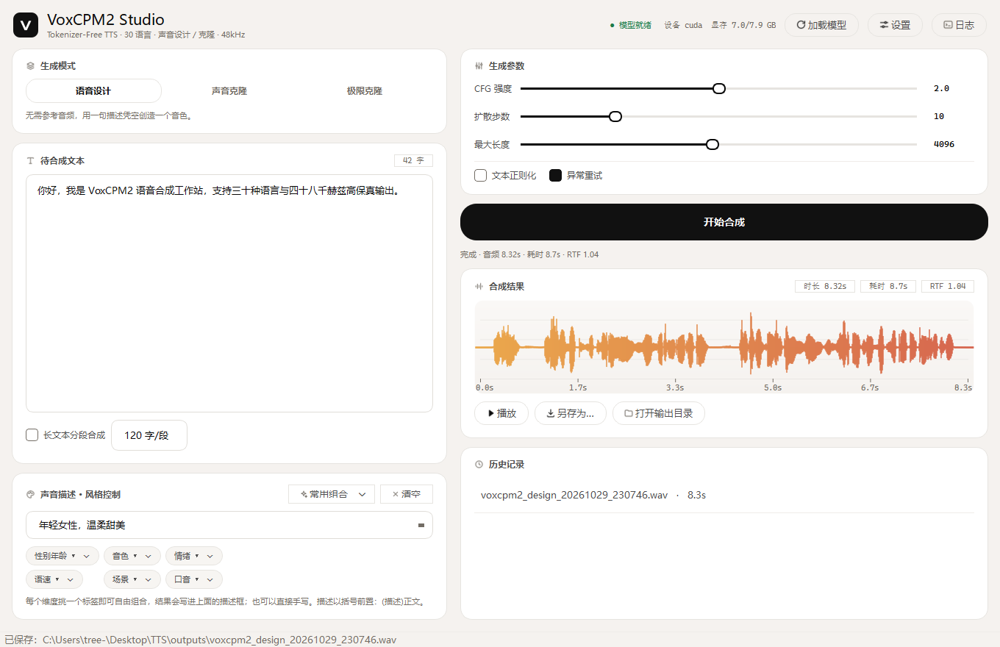
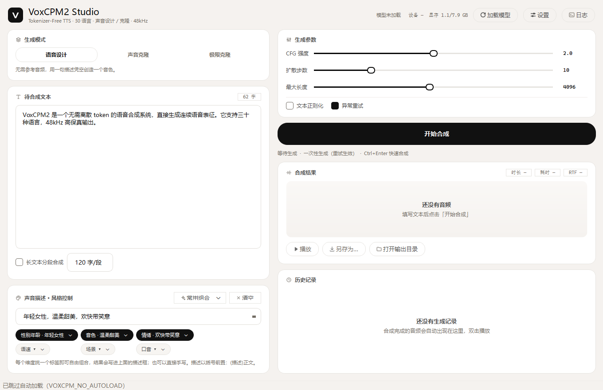
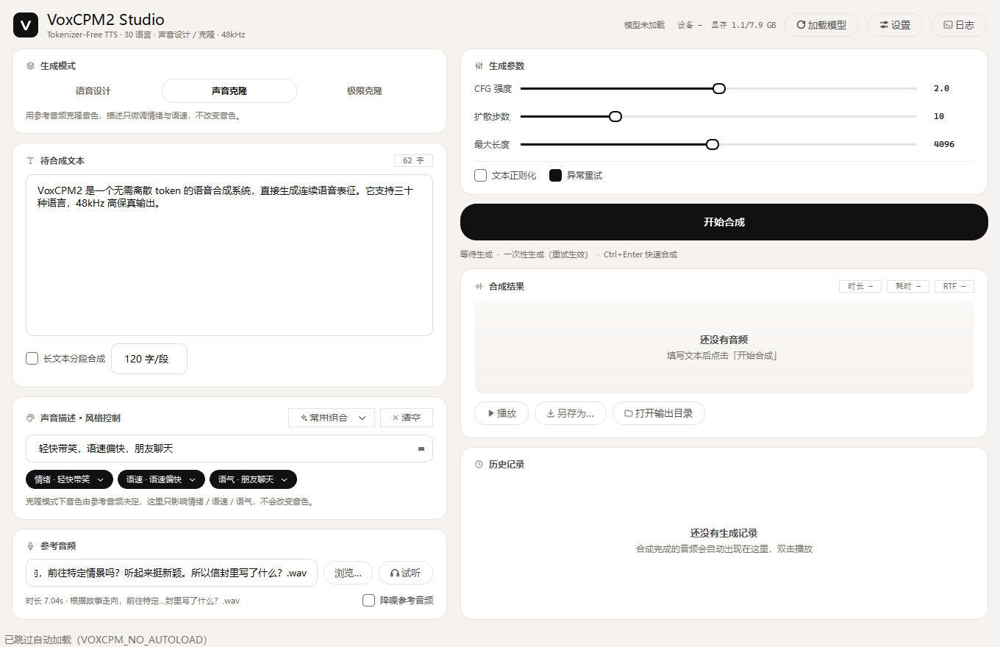
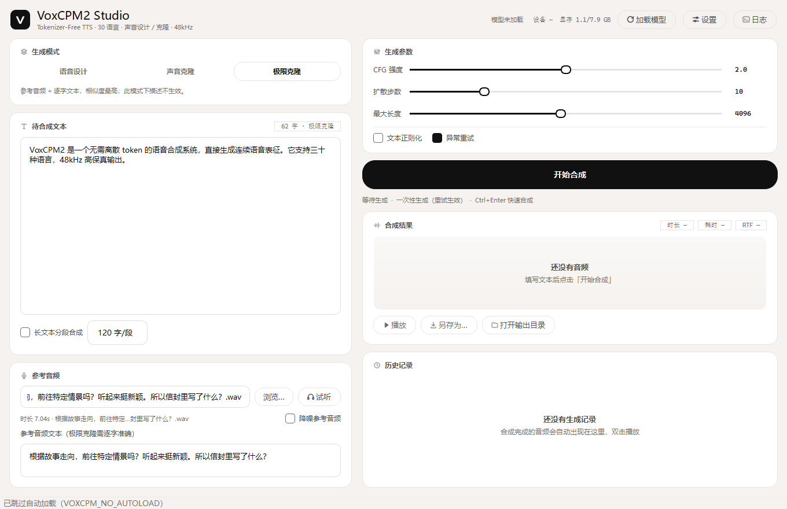
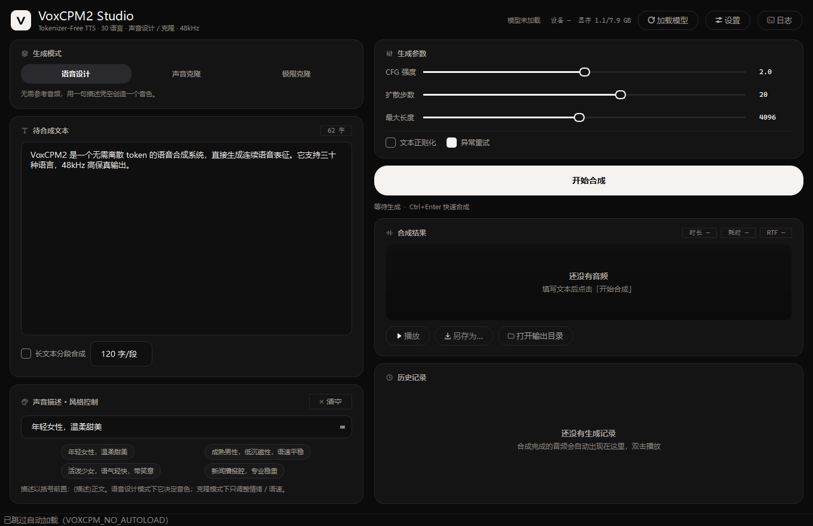

# VoxCPM2 Studio

基于 **VoxCPM2**（OpenBMB，2B，tokenizer-free TTS）的本地语音合成桌面软件，PyQt6 图形界面，Windows 开箱即用。

> **只想用、不想配环境？** 打包成便携版：`build.bat`（或从 GitHub Actions 下载构建产物），解压后双击
> `VoxCPM2Studio.exe`，首次启动会提示下载约 4.6 GB 模型（可断点续传、可取消）。



| 语音设计 | 声音克隆 | 极限克隆 | 深色主题 |
|---|---|---|---|
|  |  |  |  |

<sub>截图由 `tools/screenshot.py` / `tools/shot_result.py` 自动生成，请勿手改。</sub>

## 界面

设计规范来自 [OpenDesign](https://github.com/nexu-io/open-design) 的 `elevenlabs` 设计系统（AI 语音产品的低对比度工具感）与 `emil-design-eng` 的交互原则，做了桌面端落地：

- **两套主题**：浅色「暖白工作台」（默认，`#f5f2ef` 画布 + 纯白卡片）与深色「影院黑」（`#0b0b0c`）。在「设置 → 界面外观」切换，**重启后生效**。
- **只有一层容器**：卡片是唯一的面，卡片里不再套描边盒子；层次靠字号、字重、留白建立。
- **一个高对比元素**：主按钮是墨色药丸（浅色黑底白字 / 深色白底黑字），其余控件全部退到中灰色阶。
- **颜色只给信息**：彩色只出现在模型状态点与波形（暖橙 → 熄红渐变）。
- **可读性**：三级文字实测对比度（非估计）——浅色 `19.80 / 8.32 / 5.12`，深色 `16.77 / 7.28 / 5.04`，均 ≥ WCAG AA 4.5:1。
- **Qt 限制**：QSS 圆角一旦超过控件高度的一半会被判无效（退化成直角），所以主题里按控件高度分别给出药丸半径。

## 功能

| 模块 | 说明 |
|---|---|
| 语音设计 | 只用一句文字描述（性别/年龄/情绪/语速）凭空创造音色，无需参考音频 |
| 声音克隆 | 提供 5–30 秒参考音频克隆音色，可再用描述调整情绪与语速 |
| 极限克隆 | 参考音频 + 逐字文本，音色相似度最高（Hi-Fi 模式） |
| 长文本分段 | 按句切分后逐段合成再拼接，避免长文本掉速、爆音、显存溢出 |
| 声音描述 | 按维度挑标签自由组合（性别年龄 / 音色 / 情绪 / 语速 / 场景 / 口音），可叠加手写；另附「常用组合」与克隆模式专用标签 |
| 参数调节 | CFG 强度、扩散步数、最大长度、文本正则化、异常重试（自动切换流式 / 一次性生成） |
| 可中断 | 生成中主按钮变「停止合成」，点击即取消（流式约 0.3s 生效，非流式等当前分段跑完）；状态行实时显示「第 N/M 段 · 已生成 X.Xs」 |
| 结果处理 | 波形可视化、试听、另存为、自动保存、历史记录 |
| 工程细节 | 模型后台加载 + 预热、显存实时显示、配置持久化、拖放音频文件、可折叠运行日志（出错自动展开） |
| 界面 | 浅色 / 深色两套主题；单层卡片 + 极细描边；三级文字均 ≥ 4.5:1（WCAG AA）；窗口变矮时左右两列各自滚动，不挤压、不裁切 |
| 本地 API | HTTP + MCP 两种形态，供其它程序 / AI agent 直接调用（默认关闭，只监听 127.0.0.1） |

## 环境要求

- Windows 10/11，Python ≥ 3.10
- NVIDIA 显卡（VoxCPM2 约需 **8GB 显存**，本项目在 RTX 5060 8GB 实测可用）
- 磁盘约 6GB（模型 5GB）

## 安装

### 方式 A：便携版（解压即用）

产物来源二选一：本地跑 `build.bat zip`，或从 GitHub Actions 的 `build-windows` 产物下载（保留 14 天）。
说明：**没有提供 Releases 附件**——GitHub 限制单个 Release 资产 < 2 GiB，而带 CUDA 的便携包约 3 GB。

1. 拿到 `VoxCPM2Studio-windows-x64.zip`（约 2.9 GB），**解压**到任意目录（建议路径不含空格、磁盘留 10 GB）。
   注意：要解压出来再运行，直接在压缩包里双击 exe 会失败。
2. 双击解压出来的 `VoxCPM2Studio.exe`（`_internal` 文件夹必须和它在一起）。
   Windows 可能提示"未知发布者"，点「更多信息 → 仍要运行」（exe 未做代码签名）。
3. 首次启动弹出「需要 VoxCPM2 模型权重」：点「立即下载」（约 4.6 GB，断点续传，可随时取消）；
   已经手动下过模型的，点「我有本地模型…」直接指向那个目录。
4. 下载完自动加载模型（约 10 秒，含预热），状态点变绿即可合成。

模型与输出都放在 exe 同级的 `models/`、`outputs/`、`config.json` 下，删掉软件目录即可完全卸载。

**打包方案说明**：PyInstaller `onedir`（文件夹版），不是 `onefile`。onefile 每次启动都要把 4.8 GB 解压到临时目录，启动几十秒还占双份磁盘；模型也不打进包（否则下载量变成 7.4 GB，且权重单独分发更合规）。包内不含模型，所以首次必须联网下载一次。

### 方式 B：源码运行

```bash
pip install -r requirements.txt
python main.py
```

若还没装 CUDA 版 PyTorch（Blackwell 显卡需 cu128 及以上）：

```bash
pip install torch torchaudio --index-url https://download.pytorch.org/whl/cu128
```

## 下载模型（约 4.6 GB）

界面里会自动处理（首次启动的对话框，支持断点续传与取消）。想用命令行：

```bash
python download_model.py
```

下载器只依赖标准库（走 ModelScope 文件 API + Range 断点续传），中断后重跑会接着下。

模型默认放在 `models/VoxCPM2`，也可以在软件的「设置」里改成其它目录。
（HuggingFace 无法直连时请走 ModelScope，本软件默认从本地目录加载，不联网。）

## 运行

```bash
python main.py
```

启动后会自动加载模型（约 10–30 秒，含一次预热推理）。右上角状态点变绿即可开始合成。

## 使用说明

1. 选择 **生成模式**：
   - *语音设计*：填写文本 →（可选）填写声音描述 → 合成
   - *声音克隆*：选参考音频 → 填写文本 →（可选）风格描述 → 合成
   - *极限克隆*：选参考音频 + 逐字文本 → 填写文本 → 合成
2. 声音描述两种写法：
   - 在「声音描述」卡片里逐个维度点标签（如 性别年龄 → 年轻女性、音色 → 温柔甜美、情绪 → 欢快带笑意），程序按固定顺序拼成 `年轻女性，温柔甜美，欢快带笑意`；
   - 或者直接在输入框手写/修改。最终都会以 `(描述)正文` 前置，例如 `(年轻女性，温柔甜美)你好，世界`，中英文均可。
   克隆模式下只保留 情绪 / 语速 / 语气 三个维度——音色由参考音频决定，写音色描述无效。
3. 文本即韵律：句号/问号=长停顿，逗号=短停顿，省略号=迟疑；方言请直接写方言用词。
4. 数字、日期建议勾选「文本正则化」，否则可能逐位朗读。

### 参数建议

官方（`voxcpm` CLI 的校验器与参数说明）只对两个参数给了推荐区间：**CFG 1.0–3.0**、**扩散步数 4–30**；界面的滑块范围就锁在这两段里。VoxCPM2 没有 temperature / top_p 之类的采样参数（扩散 + LM，无采样温度）。

本软件默认取**两项的上界（3.0 / 30）**，即质量优先；代价是比 2.0 / 10 慢约 2.2 倍（实测 RTF 1.05 → 2.35）。

| 参数 | 建议 |
|---|---|
| CFG 强度 | **默认 3.0**（官方区间上界，质量优先）；长文本发虚或出现杂音时降到 1.5–2.0 |
| 扩散步数 | **默认 30**（官方区间上界，质量优先）；赶时间可降到 10，速度快约 2.2 倍 |
| 最大长度 | 4096 足够；超长文本请勾选「长文本分段合成」 |
| 文本正则化 | 含数字/日期/单位时打开 |
| 异常重试 | 保持打开。官方在**流式**模式下会强制关闭重试，所以勾选时程序自动改走一次性生成（波形在结束时出现，速度几乎无差别：实测 RTF 1.24 vs 1.26） |

## 实测性能（RTX 5060 8GB，bf16）

| 场景 | 音频时长 | 耗时 | RTF |
|---|---|---|---|
| 语音设计，**30 步 / CFG 3.0**（默认） | 6.6–7.7s | 15.4–18.1s | **2.35** |
| 语音设计，10 步 / CFG 2.0 | 6.7s | 7.0s | 1.05 |
| 语音设计，10 步（短句） | 7.7s | 7.8s | 1.02 |
| 语音设计，4 步 | 6.2s | 4.0s | 0.65 |

模型加载约 15 秒，显存占用约 7.0/7.9 GB。

## 目录结构

```
main.py                     启动入口
run.bat                     双击启动（Windows）
download_model.py / .bat    从 ModelScope 下载模型（约 5GB）
requirements.txt            Python 依赖
config.json                 首次运行后生成：参数与上次状态
voxcpm_studio/
  __init__.py
  config.py                 配置读写（dataclass + config.json）
  engine.py                 推理引擎封装（分段、流式、去噪、保存 wav）
  workers.py                后台线程（模型加载 / 合成），Qt 信号回传
  mainwindow.py             主窗口：左右分栏、设置对话框、播放器、历史记录
  widgets.py                波形控件、分段选择器、历史列表、拖放输入框、标签按钮
  icons.py                  SVG 图标加载 + 按语义色着色
  theme.py                  主题 token + QSS 生成器（浅色 / 深色两套，同一套尺度）
  presets.py                声音描述标签库（按维度组织，可自由组合）
  api.py                    本地 HTTP API（标准库实现，与界面共用引擎）
  downloader.py             模型下载（ModelScope 文件 API + Range 断点续传）
  model_setup.py            首次启动的「下载 / 指定本地目录 / 稍后」对话框
  assets/icons/*.svg        线性图标（24×24，1.8px 描边，可着色）
tools/
  e2e_test.py               端到端自检（加载模型 → 语音设计 → 声音克隆）
  screenshot.py             无需加载模型，直接渲染三种模式的界面截图
  shot_result.py            真实合成一次后再截图（检查结果区 / 波形 / 历史）
  api_test.py               HTTP API 自检（健康检查 / 合成 / 参数校验 / 异步取消）
  api_gui_test.py           验证界面里的 API 开关能起服务、关窗后端口释放
  mcp_test.py               MCP 自检（起子进程走 initialize→tools/call）
  tts_mcp_server.py         TTS 的 MCP 服务器（stdio），给 agent 当工具用
  cancel_test.py            生成中取消的界面级回归测试
  od_mcp_bridge.py          OpenDesign MCP 桥接（自动发现 daemon 端口）
  mcp_client.py             极简 MCP stdio 客户端，便于命令行调试 OpenDesign 工具
voxcpm2studio.spec          PyInstaller 打包配置（onedir，不含模型）
build.bat                   一键打包
tests/test_core.py          纯函数测试（切分 / 描述组合 / 配置往返 / API 参数校验）
.github/workflows/          CI：pytest + Windows 打包产物
docs/ROADMAP.md             优化路线与验收标准
docs/screenshots/           界面截图（README 预览图）
models/VoxCPM2/             模型权重（不纳入版本管理）
outputs/                    合成结果与自动保存的 wav（不纳入版本管理）
```

## 快捷键

| 快捷键 | 作用 |
|---|---|
| `Ctrl+Enter` / `Ctrl+Return` | 开始合成；**生成中按 = 停止** |
| `Ctrl+Space` | 播放 / 暂停 |
| `Ctrl+L` | 展开 / 收起运行日志 |

运行日志默认收起（避免空面板占版面），合成出错时会自动弹出。

## 开发与自检

```bash
python -m pytest tests -q        # 纯函数测试（33 项，0.2 秒，不需要 GPU/模型）
python tools/e2e_test.py         # 真跑一遍：加载模型 → 设计合成 → 克隆合成
python tools/screenshot.py out.png --mode design|clone|ultimate   # 不加载模型的纯界面截图
python tools/screenshot.py out.png --mode clone --ref 参考音频.wav  # 顺便填好参考音频
python tools/shot_result.py      # 真实合成一句再截图（生成 shot_result.png）
python tools/cancel_test.py      # 生成 → 中途取消 → 再生成，验证中断路径
python tools/api_test.py         # 本地 API 全链路（含异步任务取消）
python tools/mcp_test.py         # MCP 服务器全链路
python tools/api_gui_test.py     # 界面里的 API 开关与端口释放

build.bat                        # 打包成 dist\VoxCPM2Studio\VoxCPM2Studio.exe
```

`VOXCPM_NO_AUTOLOAD=1` 可跳过启动时自动加载模型（截图脚本内部已设置）。
`docs/screenshots/` 里的四张图由上面两个脚本直接生成，改界面后重跑一次即可。

## 本地 API（给程序和 AI 调用）

设置 → 勾选「启用本地 API」并选端口（默认 **8765**），保存后立即生效；只监听 `127.0.0.1`，
`GET /help` 就是接口清单。生成任务串行执行，界面正在生成时 API 返回 `409 busy`。

```bash
curl -s http://127.0.0.1:8765/health          # 模型/显存/忙闲
curl -s http://127.0.0.1:8765/presets         # 标签维度库
curl -s http://127.0.0.1:8765/params          # 默认值 + 官方推荐区间

# 用标签组合描述音色，直接拿 wav
curl -s -X POST http://127.0.0.1:8765/synthesize   -H "Content-Type: application/json"   -d '{"text":"你好，这是接口合成的语音。","mode":"design",
       "tags":{"性别年龄":"年轻女性","音色":"温柔甜美","情绪":"轻快带笑"},
       "params":{"inference_timesteps":8},
       "response_format":"wav"}' -o out.wav
```

| 端点 | 说明 |
|---|---|
| `GET /health` | 模型是否加载、设备、显存、忙闲；未加载返回 503 |
| `GET /presets` / `GET /params` | 标签维度库 / 参数默认值与推荐区间 |
| `POST /synthesize` | 合成。`text`*、`mode`、`control` 或 `tags`、`reference_audio`、`prompt_text`、`params`、`split_chars`、`stream`、`async`、`response_format`(`json`/`wav`/`base64`) |
| `GET /jobs` / `GET /jobs/{id}` | 任务列表（最近 50）/ 单个任务进度 |
| `GET /audio/{id}` | 下载该任务 wav |
| `DELETE /jobs/{id}`、`POST /cancel` | 取消任务（状态先变 `canceling`，非流式要等当前分段） |

- `reference_audio` 支持本地绝对路径或 `data:audio/wav;base64,...`；
- `stream: true` 换流式生成：取消延迟从"一个分段"降到约 0.3s，但官方会关闭异常重试；
- 若在 `config.json` 里填了 `api_token`，所有请求需带 `X-API-Key: <token>`。

### 给 AI agent 用（MCP）

`tools/tts_mcp_server.py` 把上面的 API 包装成 5 个 MCP 工具（`tts_health` / `tts_presets` /
`tts_params` / `tts_synthesize` / `tts_cancel`），只依赖标准库：

```json
{
  "mcpServers": {
    "voxcpm2-tts": {
      "command": "python",
      "args": ["C:/Users/<你>/Desktop/TTS/tools/tts_mcp_server.py"],
      "env": { "TTS_API_URL": "http://127.0.0.1:8765" }
    }
  }
}
```

接上之后 agent 可以直接说「用低沉男声把这段念出来」，它会自己 `tts_presets` 挑标签、
`tts_synthesize` 生成，并拿到 wav 路径。

## 接入 OpenDesign（可选）

界面用到的设计规范（排版尺度、层次、交互状态）来自 [OpenDesign](https://github.com/nexu-io/open-design) 的 `emil-design-eng` / `design-review` skills。
如果想让 AI 直接读写 OpenDesign 里的设计项目，需要把它的 MCP 服务器接进你的 agent：

1. 打开 Open Design 桌面端（保持运行，daemon 端口每次启动随机分配）。
2. `tools/od_mcp_bridge.py` 会自动发现端口：先读 `daemon-health.json` 拿到 pid，再用
   `netstat` 反查监听端口，最后用 `/api/health` 校验，然后启动 `od mcp --daemon-url …`（stdio 透传）。
3. 在 MCP 客户端里注册（pi 的配置在 `~/.pi/agent/mcp.json`）：

```json
{
  "mcpServers": {
    "open-design": {
      "command": "python",
      "args": ["C:/Users/<你>/Desktop/TTS/tools/od_mcp_bridge.py"],
      "timeout": 180
    }
  }
}
```

也可以用环境变量 `OD_DAEMON_URL=http://127.0.0.1:<port>` 跳过自动发现。
命令行调试（不依赖任何客户端）：

```bash
python tools/mcp_client.py tools                        # 列出工具
python tools/mcp_client.py call list_projects '{}'      # 调用单个工具
python tools/mcp_client.py seq get_active_context '{}' list_files '{}'
```

没装 OpenDesign 也不影响软件运行，这两个脚本只是设计期间的辅助工具。

## 常见问题

**显存不足 / OOM**
关闭其它占用显存的程序；或在「设置」里把运行设备改为 `cpu`（速度会明显变慢）；长文本请勾选分段合成。

**torch.compile 加速**
PyTorch 的 JIT 编译器，把逐算子执行合成融合 kernel，官方默认开启。但它**依赖 triton**，而 Windows 官方不发 triton wheel（需第三方 `triton-windows` 且版本对齐），所以本软件加载前会先探测：缺 triton 或设备不是 CUDA 时**自动跳过**，并在日志里写明原因，同时避免调用官方那段无用 warmup。8GB 卡即使装好 triton 也建议关：CUDA Graph 还要额外显存，模型本身已占 ~7.0/7.9 GB。

**想换模型路径 / 输出目录**
右上角「设置」→ 修改后需重新加载模型。

**其它程序调不通 API**
先确认「设置 → 本地 API」已勾选并保存（日志里会打印 `本地 API 已启动：http://127.0.0.1:8765`）；
端口被占用时换一个；跨机器访问需自行改 `host` 并注意没有鉴权时的暴露风险。

**想换主题**
「设置 → 界面外观」选「浅色 · 暖白工作台」或「深色 · 影院黑」，保存后重启生效（主题影响图标着色与波形配色，启动时绑定）。

**配置在哪**
项目根目录 `config.json`，删除即恢复默认。

## 后续计划

哪些做、哪些**故意不做**、以及判断依据（含实测证据）都记在 [`docs/ROADMAP.md`](docs/ROADMAP.md)。

## 许可证

代码 MIT（见 `LICENSE`）。模型权重 [OpenBMB/VoxCPM2](https://github.com/OpenBMB/VoxCPM) 为 Apache-2.0，
本仓库不分发权重，由用户首次启动时自行下载。

## 致谢

模型与推理库来自 [OpenBMB/VoxCPM](https://github.com/OpenBMB/VoxCPM)（Apache-2.0）。
